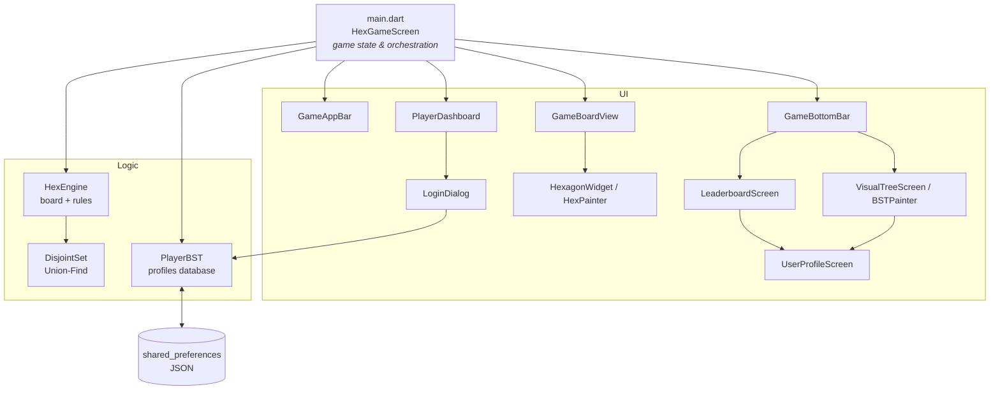

# Hex — Flutter Board Game

A cross-platform implementation of the classic connection board game **[Hex](https://en.wikipedia.org/wiki/Hex_(board_game))**, built with Flutter and Dart. Two players take turns claiming cells on an 11×11 rhombus of hexagons, each trying to build an unbroken chain between their two sides of the board.

The game is the front end. Underneath it are two classic data structures written from scratch:

- a **Disjoint Set (Union-Find)** that detects a win in near-constant time on every move, and
- a **self-balancing-on-load Binary Search Tree** that stores player profiles, drives search-as-you-type login, and is **drawn live on screen** as an interactive tree.

<!-- Add screenshots here, e.g.:
<p align="center">
  
  
</p>
-->

---

## Features

| | |
|---|---|
| **Playable Hex board** | 11×11 board drawn with a custom `CustomPainter`. Taps are mapped from screen pixels to hex cells with geometry, not per-cell widgets. |
| **Instant win detection** | Union-Find with path compression and union by rank. Each move costs amortized *O(α(n))*, which is effectively constant. |
| **Player profiles** | Search existing players by prefix or create a new one. Wins and losses are recorded automatically when a match ends. |
| **Leaderboard** | Players ranked by wins, with fewer losses as the tie-breaker. Shows win ratio and gold, silver and bronze highlights. |
| **Profile pages** | Per-player stats with win-rate bar, total matches, and profile deletion. |
| **Visual BST explorer** | The player database is rendered as a pannable, zoomable tree (`InteractiveViewer`). Tap any node to open that player's profile. |
| **Persistence** | Profiles are serialized to JSON and saved with `shared_preferences` (browser `localStorage` on web), so they survive restarts. |
| **Game-state guards** | Profiles can't be switched mid-game, the same player can't be both Red and Blue, and moves are blocked until both sides are logged in. |
| **Cross-platform** | Single codebase for Web, Windows, macOS, Linux, Android and iOS. |

---

## How the game works

- **Red** wins by connecting the **top** edge to the **bottom** edge.
- **Blue** wins by connecting the **left** edge to the **right** edge.
- Players alternate placing a stone on any empty hex. Stones are never moved or removed.
- Hex can never end in a draw: once the board fills up, exactly one player has a winning chain.

---

## Technical highlights

### 1. Win detection with Union-Find (`lib/disjoint_set.dart`, `lib/hex_engine.dart`)

The obvious way to check for a win is to run a BFS/DFS over the board after every move, which costs *O(n²)* per move. Instead, each player has their own `DisjointSet`, plus two **virtual nodes** that stand in for that player's two goal edges:

```
Red set:   [ 0 … 120 cells ] + virtualTop (121) + virtualBottom (122)
Blue set:  [ 0 … 120 cells ] + virtualLeft (121) + virtualRight (122)
```

When a stone is placed:
1. If it sits on one of the player's goal edges, it is unioned with that edge's virtual node.
2. It is unioned with every neighbouring stone of the same colour. Hex cells have six neighbours in axial coordinates: `(r-1,c) (r-1,c+1) (r,c-1) (r,c+1) (r+1,c-1) (r+1,c)`.
3. The player has won if `find(virtualA) == find(virtualB)`.

`find` uses **path compression** and `union` uses **union by rank**, which gives an amortized cost of *O(α(n))* per operation, where α is the inverse Ackermann function.

### 2. Player database as a Binary Search Tree (`lib/player_bst.dart`)

Profiles are stored in a hand-written BST keyed on the case-insensitive player name.

- **Insert / search / delete** are recursive. Deletion handles all three cases (leaf, one child, two children via the in-order successor).
- **In-order traversal** returns players alphabetically. That order feeds the login search and is also the order profiles are saved in.
- **Balanced rebuild on load:** profiles are saved to storage already sorted, so on startup the tree is rebuilt by recursively taking the middle element of each sub-list. This produces a height-balanced tree with *O(log n)* lookups, and no rotation logic is needed.
- **Prefix search** powers the search-as-you-type login dialog.

### 3. Custom rendering and hit-testing

- **`HexPainter`** computes the six corners of each hexagon with trigonometry (pointy-top orientation, `width = √3 · r`). It only repaints a cell when that cell's colour changes (`shouldRepaint`).
- **Board layout:** each row is offset by half a hex width (`x = c·w + r·w/2`, `y = r·1.5·h`), which produces the rhombus shape of a Hex board. The whole board sits in a `FittedBox`, so it scales to any screen size.
- **Tap mapping:** a single `GestureDetector` covers the board. A tap is resolved to the nearest hex centre and accepted only if it falls inside that hex's radius.
- **`BSTPainter`** recursively lays out the tree, halving the horizontal spacing at each level. While drawing, it records each node's hitbox (`Rect`), so taps on the canvas can be routed to the right profile.

---

## Architecture



| File | Responsibility |
|---|---|
| `main.dart` | App entry point. Owns game state, turn order, tap handling, match recording and the seed data. |
| `hex_engine.dart` | Board model, move validation, neighbour connection, win check. |
| `disjoint_set.dart` | Generic Union-Find with path compression and union by rank. |
| `player_bst.dart` | `PlayerProfile` model, BST operations, JSON persistence. |
| `game_board_view.dart` | Lays out the hex grid and forwards taps. |
| `hexagon_widget.dart` | Draws a single hexagon with `CustomPainter`. |
| `player_dashboard.dart` | Red and Blue player cards, turn and winner indicator. |
| `login_dialog.dart` | Search-or-create profile dialog. |
| `leaderboard_screen.dart` | Ranked player list. |
| `user_profile_screen.dart` | Player stats and delete action. |
| `visual_tree_screen.dart` | Interactive visualization of the BST. |
| `game_app_bar.dart` / `game_bottom_bar.dart` | Navigation chrome. |

---

## Getting started

**Prerequisites:** [Flutter SDK](https://docs.flutter.dev/get-started/install) with Dart ≥ 3.7.

```bash
git clone https://github.com/64bitMagician/hex_boardgame_flutter.git
cd hex_boardgame_flutter
flutter pub get

# Run in the browser
flutter run -d chrome

# …or on desktop
flutter run -d windows   # or macos / linux
```

Run the unit tests:

```bash
flutter test
```

On first launch, the database is seeded with about 50 sample players, so the leaderboard and BST view have content right away.

---

## Tech stack

- **Flutter / Dart 3**: UI and application logic
- **CustomPainter / Canvas API**: hexagon and tree rendering
- **InteractiveViewer**: pan and zoom for the tree view
- **shared_preferences**: local persistence
- **flutter_test**: 41 unit tests covering Union-Find, win detection (straight, diagonal, winding and blocked paths) and every BST operation, including persistence, the balanced rebuild and recovery from corrupted saved data
- No game or graph libraries: all data structures are implemented by hand

---

## Possible improvements

- Widget tests for the board's tap-to-cell mapping and the login flow
- Keep the BST balanced at runtime with an AVL or Red-Black tree. Today it is rebalanced only on load.
- Pie rule (swap) to offset the first-move advantage
- Highlight the winning path and add move history / undo
- Single-player mode with an AI opponent (e.g. Monte Carlo Tree Search)
- A state-management solution (Provider / Riverpod) as the app grows

---

## Author

**[64bitMagician](https://github.com/64bitMagician)**
